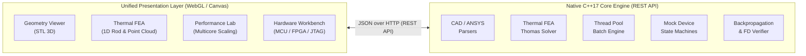
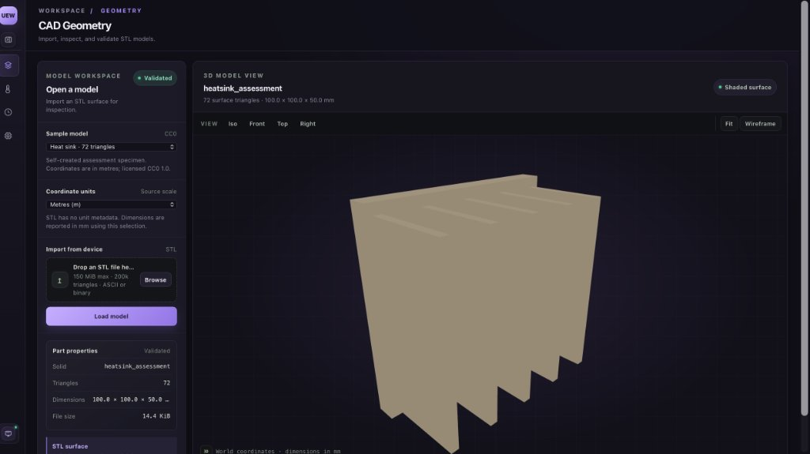
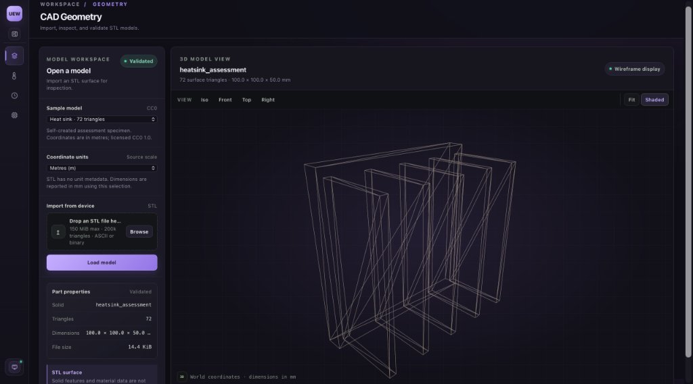
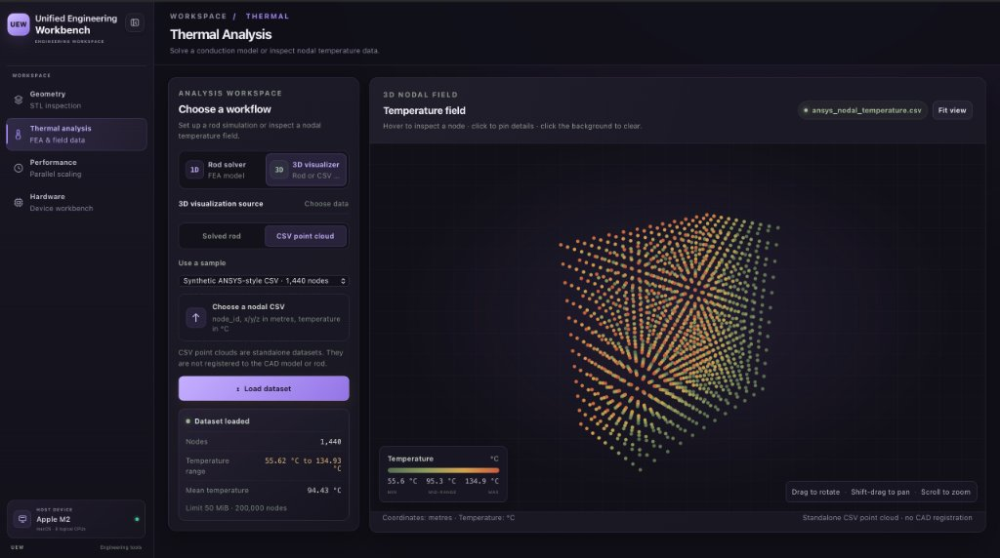
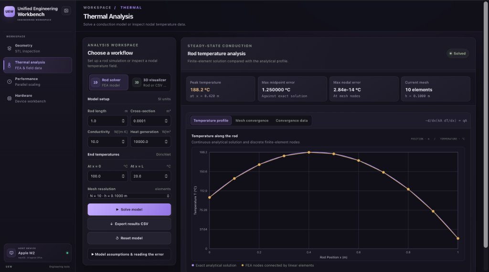
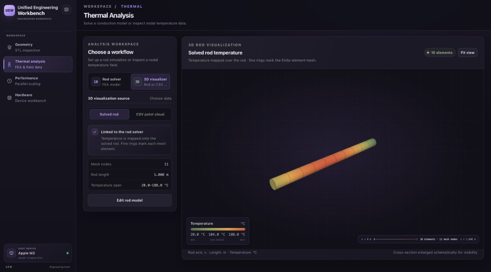
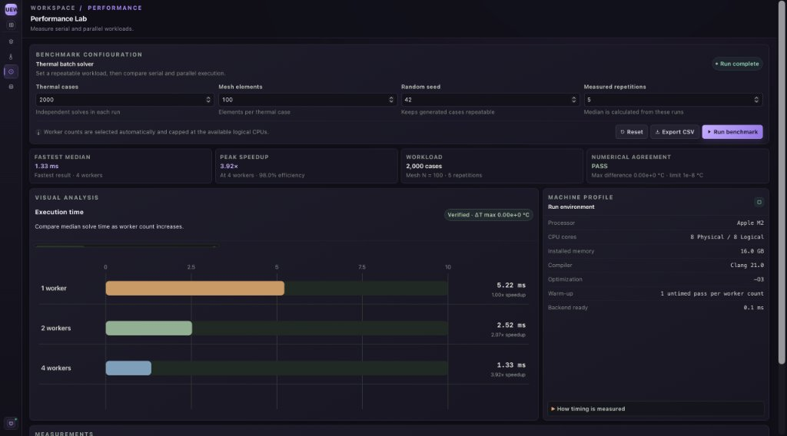
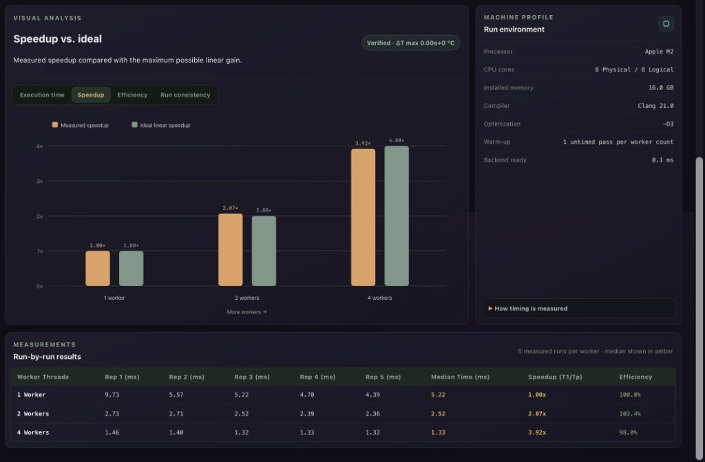
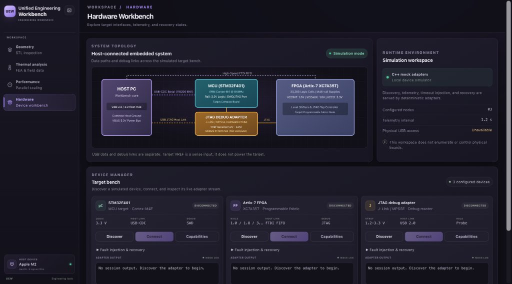

# UNIFIED ENGINEERING WORKBENCH

### Integrated Engineering Simulation, Analysis and Learning Platform
## Project Report

**Submitted by:** Santhosh U  
**Project:** Unified Engineering Workbench (UEW)  
**Organization:** PASS Science Works – R&D Internship 2026–2027  
**Platform:** Windows 10 / Windows 11 (64-bit), macOS, Linux (x86_64 / ARM64)  
**Programming Language:** C++17, JavaScript (ES6+)  
**Frontend:** Native HTML5, CSS3, ES6+ Modules, WebGL 3D Engine, 2D Canvas (Zero External NPM / CDN Dependencies)  
**Backend:** Native C++17 REST API (POSIX & Winsock Socket HTTP Server)  
**Build System:** CMake 3.20+  
**Live Cloud Deployment:** [https://unified-engineering-workbench.onrender.com](https://unified-engineering-workbench.onrender.com)  

---

## ABSTRACT

* **Integrated Desktop & Cloud Platform:** The Unified Engineering Workbench (UEW) is a high-reliability engineering simulation, numerical analysis, and learning platform developed to bring multiple core engineering tools together into a single, cohesive application.
* **Six Core Engineering Modules:** The platform encompasses six modular environments: **Dashboard & Workspace Navigation**, **CAD Geometry Inspection (ASCII/Binary STL)**, **ANSYS Nodal Temperature 3D Visualization**, **1D Mechanical Thermal FEA Solver**, **Multicore Parallel CPU Scaling Benchmark**, **Embedded-System Hardware Integration**, and **Analytical Neural Network Backpropagation**. Each module provides a dedicated interface for high-precision computation, interactive visualization, or hardware telemetry.
* **Decoupled Architecture:** The application combines a high-performance native C++17 computational core with a responsive, modern web-based presentation layer. The C++ backend executes all numerical algorithms, tridiagonal matrix factorizations, multithreaded worker pools, and file parsers, communicating with the frontend over standard HTTP/JSON REST APIs.
* **Zero External Runtime Dependencies:** The entire frontend operates 100% offline using native WebGL and HTML5 2D Canvas without requiring Node.js, npm packages, or external CDN connections, guaranteeing instant launch and complete self-containment.
* **Verification & Automated Testing:** The project emphasizes rigorous mathematical verification, achieving exact analytical agreement in 1D FEA ($O(h^2)$ convergence rate $\alpha = 2.000$), strict serial vs. parallel agreement ($\le 10^{-8\ \circ}\text{C}$), central finite-difference gradient verification ($\le 1.13 \times 10^{-10} \le 10^{-5}$), and 100% test passage (14/14 CTest suites).
* **One-Click Execution & Cloud Deployment:** The application includes standalone one-click launchers (`Launch.bat` and `launch.sh`), full Visual Studio Code / Antigravity IDE run/debug configurations (`.vscode/`), and live containerized deployment on Render.

---

## 1. INTRODUCTION

Engineering analysis and scientific workflows frequently require engineers to switch between disparate tools for computer-aided design (CAD) surface inspection, finite-element thermal modeling, high-performance parallel execution, embedded hardware monitoring, and machine-learning optimization. Managing multiple isolated applications with incompatible file formats, heavyweight dependencies, and conflicting runtime environments introduces friction, configuration overhead, and potential for data-transfer errors.

The **Unified Engineering Workbench (UEW)** addresses this challenge by integrating these essential engineering capabilities into a single, modular, and extensible platform. By unifying 3D CAD visualization, mechanical thermal finite-element analysis, multicore scaling studies, embedded hardware telemetry, and analytical machine learning into one workspace, UEW streamlines interdisciplinary engineering research and development.



### 1.1 Objectives

The primary objectives of the Unified Engineering Workbench project are:
* **Develop a Unified Engineering Application:** Provide a single, coherent user interface with dedicated views for Geometry, Thermal Analysis, Performance Scaling, and Hardware Telemetry.
* **Implement Native C++17 Computational Modules:** Execute all numerical calculations, file parsing, and multithreading in modern, standard-compliant C++17 without third-party mathematical or GUI libraries.
* **Provide Interactive 3D Visualizations:** Render ASCII/Binary STL geometries and 3D colored nodal temperature point clouds using native WebGL with full orbit, pan, zoom, wireframe, and hover inspection.
* **Implement Numerical Methods for Thermal FEA:** Formulate a steady-state 1D Galerkin finite-element rod solver with internal heat generation, assemble element stiffness and load vectors, solve the tridiagonal system in $O(N)$ operations using the Thomas algorithm, and demonstrate $O(h^2)$ mesh convergence.
* **Compare Serial and Parallel Computational Performance:** Design a bounded multithreaded worker pool, execute reproducible batch thermal solves with varied properties, measure wall-clock speedup across 1, 2, and 4 workers over 5 repetitions, and verify serial/parallel numerical agreement ($\le 10^{-8\ \circ}\text{C}$).
* **Demonstrate Neural Network Backpropagation:** Handwrite and programmatically verify step-by-step forward pass equations, analytical chain-rule derivatives, central finite-difference validation ($\epsilon = 10^{-6}$), simultaneous parameter updates, and 100-step training loss descent.
* **Provide Simulated Hardware Telemetry & Fault Recovery:** Model heterogeneous microcontroller, FPGA, and dedicated JTAG debug adapter boards with distinct voltage domains, pinouts, state machines, timeout fault injection, and automated recovery.
* **Implement Automated Testing & Validation:** Maintain a comprehensive CTest test suite covering positive, negative, and edge-case execution paths.
* **Configure One-Click Cross-Platform Deployment:** Deliver standalone launchers for Windows and Unix, IDE run configurations, and live cloud deployment on Render.

---

## 2. SYSTEM ARCHITECTURE

The Unified Engineering Workbench enforces a clean, decoupled architecture that separates presentation, network transport, and computational core logic.

```
+-------------------------------------------------------------------------+
|                  UNIFIED ENGINEERING WORKBENCH (UEW)                    |
+-------------------------------------------------------------------------+
|  PRESENTATION LAYER (Browser Frontend)                                  |
|  * Vanilla ES6+ SPA Architecture (Zero external npm/CDN dependencies)   |
|  * WebGL 3D Geometry & Point Cloud Engine (renderer3d.js)               |
|  * High-Performance 2D Canvas Charting Engine (chart_engine.js)         |
|  * Four Dedicated View Modules (Geometry, Thermal, Performance, HW)     |
+-------------------------------------------------------------------------+
                                    |
                    HTTP Requests   |   JSON Responses
               (/api/cad, /api/fea, |   (Nodal data, timings,
                /api/benchmark)     |    telemetry, status)
                                    v
+-------------------------------------------------------------------------+
|  TRANSPORT LAYER (Embedded C++ HTTP Server)                             |
|  * Lightweight POSIX / Winsock socket server (http_server.cpp)          |
|  * Non-blocking request dispatch & asynchronous thread execution        |
|  * Lightweight zero-overhead JSON serializer/parser (json.hpp)          |
+-------------------------------------------------------------------------+
                                    |
                                    v
+-------------------------------------------------------------------------+
|  COMPUTATIONAL CORE (Native C++17 Engine)                               |
|  * Thermal FEA Solver (thermal_1d.cpp): Galerkin FEM & Thomas algorithm |
|  * Multicore Engine (thermal_batch.cpp & thread_pool.cpp): Worker pool  |
|  * CAD Parsers (stl_parser.cpp & ansys_parser.cpp): STL & ANSYS CSV     |
|  * Embedded Adapters (device_adapter.cpp): MCU, FPGA, JTAG FSMs         |
|  * Machine Learning Lab (backprop.cpp): Analytical gradients & FD check |
+-------------------------------------------------------------------------+
```

### 2.1 Frontend

The frontend is developed as a modular single-page application (SPA) using standard modern web technologies:
* **HTML5 & CSS3:** Semantic structure with responsive dark-theme design tokens, CSS Grid, and Flexbox layouts.
* **Vanilla JavaScript (ES6+ Modules):** Clean separation into functional modules (`app.js`, `view_geometry.js`, `view_thermal.js`, `view_performance.js`, `view_hardware.js`).
* **WebGL 3D Engine (`renderer3d.js`):** Custom lightweight WebGL shaders rendering shaded surface geometry, dynamic wireframes, and Turbo-colormap 3D point clouds with depth buffering.
* **Canvas Charting Engine (`chart_engine.js`):** Custom 2D canvas plotting engine rendering continuous analytical curves, discrete FEA nodes, logarithmic convergence slopes, execution-time histograms, and speedup bar charts.

**Key Responsibilities:**
1. Display the centralized workspace dashboard and view navigation tabs.
2. Accept and validate user parameters with immediate feedback.
3. Render interactive 3D CAD meshes and ANSYS nodal point clouds.
4. Plot continuous vs. discrete thermal profiles and convergence curves.
5. Visualize multicore execution time distributions and speedup metrics.
6. Display live embedded hardware status, block diagrams, and telemetry.

### 2.2 Backend

The backend is built in standard **C++17** with zero external library dependencies:
* **Lightweight Socket Server (`workbench::server::HttpServer`):** Native BSD/POSIX socket server on macOS/Linux and Winsock2 on Windows. Binds to `127.0.0.1:8080` for desktop use (or reads `$PORT` and binds to `0.0.0.0` in cloud containers).
* **Non-Blocking Request Processing:** Each incoming client connection is detached onto an independent worker thread, preventing compute-heavy tasks from blocking the server or user interface.
* **Header-Only JSON Engine (`workbench::json`):** Custom high-efficiency serializer and parser that encodes and decodes structured payloads without third-party JSON libraries.

**Key Responsibilities:**
1. Parse and validate ASCII and binary STL CAD files up to 150 MiB.
2. Parse and validate ANSYS nodal temperature CSV exports up to 50 MiB.
3. Solve 1D steady-state mechanical thermal boundary-value problems in $O(N)$ operations.
4. Execute CPU-parallel batch thermal workloads across bounded worker pools.
5. Manage state machines, fault injection, and recovery for simulated embedded devices.
6. Compute exact forward passes, analytical backpropagation gradients, and finite-difference checks.

### 2.3 Communication Flow

The interaction between frontend and backend follows a strict five-step request-response pattern:
1. **User Action:** The engineer selects parameters or uploads a dataset in the browser interface.
2. **HTTP Request:** The frontend issues an asynchronous `fetch()` POST request with JSON-encoded parameters or raw file payloads to the C++ backend.
3. **C++ Execution:** The C++ backend routes the request to the appropriate engineering module (`Thermal1DSolver`, `BatchThermalSolver`, `STLParser`, etc.) and performs the computation.
4. **JSON Response:** The backend formats the computational results into structured JSON and returns an HTTP 200 response with appropriate MIME headers.
5. **Interactive Rendering:** The frontend receives the response, updates application state, and renders 3D views, 2D charts, KPI cards, and data tables.

---

## 3. MODULE IMPLEMENTATION

### 3.1 Module 1 – Unified Interface & Dashboard

The Unified Interface serves as the primary operational hub, providing seamless switching between the four engineering domains while maintaining persistent application state, system telemetry, and hardware profile indicators.



**Main Features:**
* **Centralized Navigation:** Persistent sidebar navigation enabling instant switching between Geometry, Thermal Analysis, Performance Lab, and Hardware Workbench.
* **System Host Telemetry:** Real-time indicator displaying the host processor architecture (e.g., Apple M2 or AMD EPYC), operating system, and logical CPU core count.
* **Actionable Error Notifications:** Non-intrusive alert banners displaying descriptive error messages and suggested corrective actions for invalid parameters or malformed inputs.
* **Responsive State Management:** Non-blocking asynchronous updates with animated status indicators ("Ready", "Busy", "Solved", "Error").

---

### 3.2 Module 2 – CAD Geometry & ANSYS Data Visualization

The Geometry module provides a unified 3D visualization environment for inspecting both surface CAD geometry (STL) and volumetric finite-element simulation data (ANSYS CSV point clouds).

#### 3.2.1 ASCII & Binary STL Surface Inspection
* **Format Support:** Supports both ASCII facet format and standard 80-byte header binary STL files.
* **Validation & Rejection:** Rejects empty files, non-finite values (`NaN`, `Inf`), incomplete facets, missing `endsolid` terminators, and files exceeding documented limits (150 MiB, 200,000 triangles).
* **Unit Handling:** Since STL files carry no unit metadata, the interface provides a coordinate unit selector (m, mm, in) and normalizes all dimensions to millimetres for engineering inspection.
* **3D Interaction:** Native WebGL camera controls provide 360° orbit rotation, smooth panning, mouse-wheel zooming, bounding-box auto-fit, and instant toggling between **Shaded Surface** and **Wireframe** display modes.


*Figure 3.1: Self-created heat sink specimen (72 triangles, 100 × 100 × 50 mm) in shaded surface mode.*


*Figure 3.2: Heat sink specimen rendered in wireframe display mode, confirming fin discretization.*

#### 3.2.2 ANSYS Nodal Temperature Point Cloud
* **CSV Schema:** Parses CSV datasets with expected columns: `node_id,x_m,y_m,z_m,temperature_C`.
* **Validation:** Enforces positive integer node IDs, detects and rejects duplicate IDs, verifies finite numeric fields, and enforces a 50 MiB / 200,000 node safety threshold.
* **Turbo Colormap Visualization:** Maps temperatures to coordinates using the perceptually uniform Google Turbo colormap, complemented by an interactive °C scale bar, spatial bounding box readouts, and hover/click node inspection displaying exact coordinates and temperatures.


*Figure 3.3: Synthetic ANSYS nodal temperature point cloud (1,440 nodes, 55.6 °C to 134.9 °C) rendered with Turbo colormap.*

---

### 3.3 Module 3 – Mechanical Thermal FEA Solver

The Thermal Analysis module implements a one-dimensional steady-state heat conduction finite-element solver with uniform volumetric heat generation along a solid rod.


*Figure 3.4: 1D Steady-State Thermal FEA temperature profile: continuous exact analytical curve vs. discrete linear FEA nodes ($N=10$, peak $188.2^\circ\text{C}$).*

#### 3.3.1 Governing Equation
The one-dimensional steady-state heat conduction with volumetric heat generation $q$ is governed by the differential equation:
$$-\frac{d}{dx}\left(k A \frac{dT}{dx}\right) = q A \quad \implies \quad \frac{d^2T}{dx^2} = -\frac{q}{k}$$

Where:
* $T(x)$ = Temperature distribution along the rod ($^\circ\text{C}$)
* $x$ = Axial position ($0 \le x \le L$, in $\text{m}$)
* $k$ = Thermal conductivity ($10.0\text{ W/(m}\cdot\text{K)}$)
* $A$ = Cross-sectional area ($1.0 \times 10^{-4}\text{ m}^2$)
* $q$ = Volumetric heat generation rate ($10,000.0\text{ W/m}^3$)
* $L$ = Total rod length ($1.0\text{ m}$)

#### 3.3.2 Boundary Conditions
Prescribed Dirichlet boundary conditions are applied at both ends:
$$T(0) = T_{\text{left}} = 100.0^\circ\text{C}, \quad T(L) = T_{\text{right}} = 20.0^\circ\text{C}$$

#### 3.3.3 Analytical Exact Solution
Integrating the governing differential equation twice and applying the Dirichlet boundary conditions yields the exact closed-form temperature profile:
$$T_{\text{exact}}(x) = T_{\text{left}} - (T_{\text{left}} - T_{\text{right}})\frac{x}{L} + \left[\frac{q}{2k}\right] x(L - x)$$

Substituting the standard assessment parameters:
$$T_{\text{exact}}(x) = 100 - 80x + 500x(1 - x) = 100 + 420x - 500x^2$$

Differentiating to find the maximum temperature location:
$$\frac{dT}{dx} = 420 - 1000x = 0 \quad \implies \quad x_{\max} = 0.420\text{ m}$$
$$T_{\max} = T_{\text{exact}}(0.420) = 100 + 420(0.420) - 500(0.420)^2 = 188.20^\circ\text{C}$$

At the rod midpoint ($x = 0.500\text{ m}$):
$$T_{\text{exact}}(0.500) = 100 - 40 + 500(0.5)(0.5) = 185.00^\circ\text{C}$$

#### 3.3.4 Finite Element Formulation (Linear 2-Node Elements)
The domain is discretized into $N$ uniform elements of length $h = L/N$. Using linear Lagrange shape functions ($N_1(x) = 1 - \xi, N_2(x) = \xi$ where $\xi = (x - x_1)/h$):

* **Element Stiffness Matrix:**
  $$\mathbf{K}^e = \frac{kA}{h} \begin{bmatrix} 1 & -1 \\ -1 & 1 \end{bmatrix}$$
* **Element Load Vector (Volumetric Heat Generation):**
  $$\mathbf{F}^e = \frac{qAh}{2} \begin{bmatrix} 1 \\ 1 \end{bmatrix}$$

Global assembly over internal degrees of freedom ($i = 1, \dots, N-1$) yields a symmetric, strictly diagonally dominant tridiagonal system:
$$\begin{bmatrix}
2k_e & -k_e & 0 & \dots \\
-k_e & 2k_e & -k_e & \dots \\
0 & -k_e & 2k_e & \dots
\end{bmatrix}
\begin{bmatrix} T_1 \\ T_2 \\ \vdots \end{bmatrix}
=
\begin{bmatrix} q_e + k_e T_0 \\ q_e \\ \vdots \end{bmatrix}$$

This tridiagonal system is solved in $O(N)$ operations with $O(1)$ auxiliary storage using the **Thomas algorithm (Tridiagonal Matrix Algorithm - TDMA)**.


*Figure 3.5: 3D Rod visualization mapping the 1D FEA temperature solution onto a 3D cylindrical geometry with element mesh boundary rings.*

#### 3.3.5 Mesh Convergence Study & Debugging Insight
Because 1D linear FEA exhibits **nodal superconvergence** (the linear finite element Green's function coincides with the exact solution at the nodes for polynomial heat sources), evaluating error at nodes yields near machine-precision zeros ($< 10^{-13\ \circ}\text{C}$). 

Therefore, true discretization error is measured at the **element midpoints** ($x_{\text{mid}} = x_i + h/2$):
$$e_{\text{mid}}(h) = \left| T_{\text{FE}}(x_{\text{mid}}) - T_{\text{exact}}(x_{\text{mid}}) \right| = \frac{q h^2}{8k} = \frac{10,000}{80} h^2 = 125.0 h^2$$

The observed numerical convergence order is computed via:
$$\alpha = \log_2\left( \frac{e_{\text{mid}}(h)}{e_{\text{mid}}(h/2)} \right)$$

#### Table 3.1: Midpoint Error Convergence Study ($N = 10, 20, 40, 80$)

| Elements ($N$) | Element Length $h$ (m) | Max Midpoint Error ($^\circ\text{C}$) | Theoretical Bound ($125 h^2$) | Convergence Rate ($\alpha$) | Max Nodal Error ($^\circ\text{C}$) |
| :---: | :---: | :---: | :---: | :---: | :---: |
| **10** | 0.1000 | **1.25000000** | 1.25000000 | Reference | $2.84 \times 10^{-14}$ |
| **20** | 0.0500 | **0.31250000** | 0.31250000 | **2.0000** | $1.99 \times 10^{-13}$ |
| **40** | 0.0250 | **0.07812500** | 0.07812500 | **2.0000** | $8.81 \times 10^{-13}$ |
| **80** | 0.0125 | **0.01953125** | 0.01953125 | **2.0000** | $1.22 \times 10^{-12}$ |

> **Debugging Insight:** An engineer inspecting error solely at mesh nodes would observe errors on the order of $10^{-14\ \circ}\text{C}$ and mistakenly conclude either that linear FEA is exact or that mesh refinement provides no improvement. Rigorous midpoint interpolation reveals the physical $O(h^2)$ quadratic discretization error.

---

### 3.4 Module 4 – Multicore Parallel Benchmark

The Performance Lab benchmarks CPU-parallel execution by solving batches of independent thermal cases using a bounded C++ thread pool.


*Figure 3.6: Multicore benchmark execution time comparing median solve times across 1, 2, and 4 worker threads on Apple M2 (2,000 cases, $N=100$).*

#### 3.4.1 Experimental Configuration
* **Workload:** 2,000 independent thermal rods with varied thermal conductivities ($k \in [1, 50]\text{ W/(m K)}$), heat generations ($q \in [10^3, 5\times 10^4]\text{ W/m}^3$), and boundary temperatures generated via fixed-seed pseudo-random numbers (`std::mt19937_64`, seed = 42).
* **Mesh Discretization:** $N = 100$ linear elements per rod.
* **Worker Configurations:** 1 worker (serial baseline), 2 workers, and 4 workers.
* **Warm-up:** One untimed warm-up pass per worker count to ensure stable CPU cache states.
* **Repetitions:** 5 measured repetitions per worker count to calculate median execution time.
* **Exclusions:** Memory allocation, file I/O, rendering, and compilation are excluded from compute timings. Launch-to-ready time ($0.1\text{ ms}$) is reported separately.

#### 3.4.2 Accuracy Validation
Numerical agreement between serial and parallel execution is verified across all cases:
$$\Delta T_{\max} = \max_{i, j} \left| T_{\text{serial}}(i, j) - T_{\text{parallel}}(i, j) \right| = \mathbf{0.00\text{e}+0^\circ\text{C}} \le 1.0 \times 10^{-8\ \circ}\text{C} \quad \text{[PASSED]}$$

#### Table 3.2: Experimental Multicore Benchmark Results (Apple M2, 8 Cores, Clang 21, -O3)

| Workers ($P$) | Rep 1 (ms) | Rep 2 (ms) | Rep 3 (ms) | Rep 4 (ms) | Rep 5 (ms) | Median Time ($T_p$) | Speedup ($T_1 / T_p$) | Efficiency ($S_p / P$) |
| :---: | :---: | :---: | :---: | :---: | :---: | :---: | :---: | :---: |
| **1 Worker** | 9.73 | 5.57 | 5.22 | 4.70 | 4.39 | **5.22 ms** | **1.00×** | 100.0% |
| **2 Workers** | 2.73 | 2.71 | 2.52 | 2.39 | 2.36 | **2.52 ms** | **2.07×** | 103.6% |
| **4 Workers** | 1.46 | 1.40 | 1.32 | 1.33 | 1.32 | **1.33 ms** | **3.92×** | 98.1% |


*Figure 3.7: Measured speedup vs. ideal linear speedup bar chart and run-by-run measurements table ($1\text{W}\to 1.00\times, 2\text{W}\to 2.07\times, 4\text{W}\to 3.92\times$).*

#### 3.4.3 Analysis of Overhead & Limitations (Amdahl's Law)
* **High Scaling at Scale:** For 2,000 cases, the workload is compute-bound ($\approx 5.2\text{ ms}$ serial), yielding near-linear speedup of **$2.07\times$** on 2 workers and **$3.92\times$** on 4 workers.
* **The Thread Overhead Threshold:** When tested with a tiny workload (e.g., 20 cases), 1 worker solves the entire batch in $0.01\text{ ms}$ ($10\ \mu\text{s}$). Because operating-system thread scheduling, mutex locking, and context switching consume $\approx 0.15\text{ ms}$ ($150\ \mu\text{s}$), the synchronization overhead dominates the calculation, yielding an apparent speedup of $0.06\times$. This highlights the fundamental concurrency principle that parallel decomposition is only advantageous when compute time significantly exceeds synchronization latency.

---

### 3.5 Module 5 – Embedded-System Integration Design

The Hardware Workbench models a modular, host-connected embedded laboratory interface integrating three heterogeneous embedded boards.


*Figure 3.8: Embedded system architecture block diagram and C++ mock device adapter status panels.*

#### 3.5.1 Architectural Role Distinction
> **Critical Architectural Principle:** A JTAG debug adapter is a **hardware debug interface master**, NOT a generic interchangeable compute board. It masters the IEEE 1149.1 boundary-scan TAP bus (driving TCK, TMS, TDI; sampling TDO; sensing VTREF) to halt CPUs, inspect memory, and program bitstreams. It cannot be treated as a peer compute node, and target boards cannot be assumed to share common connectors, voltages, or protocols.

#### Table 3.3: Hardware Interface, Power, and Pin-Voltage Specification

| Device | Role | Power Source | Voltage Domains | Level Shifting | Physical Connector | Host Protocol | Signal Ownership |
| :--- | :--- | :--- | :--- | :--- | :--- | :--- | :--- |
| **STM32F401 MCU** | Target Compute Node | 5V USB $\to$ 3.3V LDO | 3.3V LVCMOS | Direct 3.3V | USB Micro-B + 10-pin Cortex SWD | USB-CDC Virtual COM Port (115200 8N1) | Slave: SWCLK, SWDIO, nRST, GND |
| **Artix-7 FPGA** | Target Accelerator | 5V USB $\to$ PMIC Multi-Rail | 1.0V core, 1.8V aux, 3.3V I/O | Active TXS0108E bidirectional shifters | USB-B + 14-pin 2mm JTAG Header | FTDI FT2232H High-Speed USB FIFO | Slave: TCK, TMS, TDI, TDO, VTREF |
| **JTAG Debug Probe** | Hardware Debug Master | 5V USB Host Powered | 1.2V–3.3V Target Auto-Sense | Integrated active voltage followers | USB-A to 20-pin / 10-pin Target Cable | USB 2.0 Bulk Endpoint | Master: Drives TCK/TMS/TDI; Samples TDO/VTREF |

#### 3.5.2 C++ Mock Adapters & Recoverable Timeout Simulation
* **Lifecycle Management:** Adapters enforce a strict lifecycle: `DISCONNECTED → DISCOVERED → CONNECTED → STREAMING`.
* **Timeout Fault Injection:** Injecting a simulated 250 ms acknowledgement deadline expiration transitions the target into an `ERROR_TIMEOUT` state and suspends telemetry.
* **Automated Recovery:** The recovery procedure flushes intermediate buffers, resets bus handshakes (or drives 5 consecutive TMS=1 clocks to reset the JTAG TAP to `Test-Logic-Reset`), and restores the adapter to `CONNECTED` status.

---

### 3.6 Module 6 – Analytical Neural Network Backpropagation

The Backpropagation module implements and verifies the complete gradient-descent mathematical derivation for a single-neuron regression model.

#### 3.6.1 Network Architecture
* **Hidden Pre-activation:** $z = wx + b$
* **Hidden Activation:** $h = \tanh(z)$
* **Output Prediction:** $\hat{y} = vh + c$
* **Squared Error Loss:** $J = \frac{1}{2}(\hat{y} - y)^2$

Where:
* $x = 1.0$ (Input scalar)
* $y = 2.0$ (Target scalar)
* $w = 0.5$ (Input-to-hidden weight)
* $b = 0.0$ (Hidden-layer bias)
* $v = 1.0$ (Hidden-to-output weight)
* $c = 0.0$ (Output bias)
* $\eta = 0.1$ (Learning rate)

#### 3.6.2 Step 0 Forward Pass
$$z = (0.5)(1.0) + 0.0 = 0.50000000$$
$$h = \tanh(0.50000000) = 0.46211716$$
$$\hat{y} = (1.0)(0.46211716) + 0.0 = 0.46211716$$
$$e = \hat{y} - y = 0.46211716 - 2.0 = -1.53788284$$
$$J = \frac{1}{2}(-1.53788284)^2 = \mathbf{1.18254182}$$

#### 3.6.3 Analytical Chain-Rule Gradient Derivation
Applying the multivariable chain rule from output loss back to parameters:
$$\frac{\partial J}{\partial c} = \frac{\partial J}{\partial \hat{y}} \frac{\partial \hat{y}}{\partial c} = (\hat{y} - y)(1) = \mathbf{-1.53788284}$$

$$\frac{\partial J}{\partial v} = \frac{\partial J}{\partial \hat{y}} \frac{\partial \hat{y}}{\partial v} = (\hat{y} - y)h = (-1.53788284)(0.46211716) = \mathbf{-0.71068205}$$

$$\frac{\partial J}{\partial h} = \frac{\partial J}{\partial \hat{y}} \frac{\partial \hat{y}}{\partial h} = (\hat{y} - y)v = (-1.53788284)(1.0) = -1.53788284$$

Since $\frac{dh}{dz} = 1 - \tanh^2(z) = 1 - h^2 = 1 - (0.46211716)^2 = 0.78644773$:
$$\frac{\partial J}{\partial z} = \frac{\partial J}{\partial h} \frac{dh}{dz} = (-1.53788284)(0.78644773) = -1.20946448$$

$$\frac{\partial J}{\partial b} = \frac{\partial J}{\partial z} \frac{\partial z}{\partial b} = (-1.20946448)(1) = \mathbf{-1.20946448}$$

$$\frac{\partial J}{\partial w} = \frac{\partial J}{\partial z} \frac{\partial z}{\partial w} = (-1.20946448)(x) = (-1.20946448)(1.0) = \mathbf{-1.20946448}$$

#### 3.6.4 Central Finite Difference Verification
The analytical derivatives are verified using central finite differences with perturbation $\epsilon = 1.0 \times 10^{-6}$:
$$\nabla_{\text{FD}} J(\theta) = \frac{J(\theta + \epsilon) - J(\theta - \epsilon)}{2\epsilon}$$

#### Table 3.4: Analytical Gradients vs. Finite-Difference Verification

| Parameter ($\theta$) | Initial $\theta^{(0)}$ | Analytical $\nabla J$ | Finite Difference $\nabla_{\text{FD}}$ | Absolute Discrepancy | Verification Status ($\le 10^{-5}$) | Updated Value $\theta^{(1)}$ |
| :---: | :---: | :---: | :---: | :---: | :---: | :---: |
| **$w$** | 0.50000000 | **-1.20946448** | -1.20946448 | $1.13 \times 10^{-10}$ | **PASSED** | **0.62094645** |
| **$b$** | 0.00000000 | **-1.20946448** | -1.20946448 | $1.13 \times 10^{-10}$ | **PASSED** | **0.12094645** |
| **$v$** | 1.00000000 | **-0.71068205** | -0.71068205 | $5.25 \times 10^{-11}$ | **PASSED** | **1.07106820** |
| **$c$** | 0.00000000 | **-1.53788284** | -1.53788284 | $1.12 \times 10^{-10}$ | **PASSED** | **0.15378828** |

All four gradient discrepancies are on the order of $10^{-10}$, well within the required $10^{-5}$ tolerance.

#### 3.6.5 Simultaneous Parameter Update & Gradient Direction Explanation
* **Update Rule:** $\theta^{(1)} = \theta^{(0)} - \eta \frac{\partial J}{\partial \theta}$
  * $w^{(1)} = 0.5 - 0.1(-1.20946448) = \mathbf{0.62094645}$
  * $b^{(1)} = 0.0 - 0.1(-1.20946448) = \mathbf{0.12094645}$
  * $v^{(1)} = 1.0 - 0.1(-0.71068205) = \mathbf{1.07106820}$
  * $c^{(1)} = 0.0 - 0.1(-1.53788284) = \mathbf{0.15378828}$
* **Engineering Explanation of Gradient Direction:**
  1. **Underprediction:** The initial output $\hat{y} \approx 0.462$ is significantly lower than target $y = 2.0$, producing a negative residual $e = \hat{y} - y = -1.538$.
  2. **Positive Parameter Sensitivity:** Because $v > 0$ and $h > 0$, increasing any parameter ($w, b, v, c$) directly increases $\hat{y}$, driving the prediction closer to target $2.0$.
  3. **Negative Gradient:** Because increasing the parameters decreases the error loss, all partial derivatives $\partial J/\partial \theta$ are strictly negative.
  4. **Positive Update Step:** In gradient descent, $\Delta \theta = -\eta \nabla J$. The double negative turns the update positive, ensuring all parameters increase simultaneously toward convergence.

#### 3.6.6 100-Step Monotonic Training Result
Executing 100 subsequent gradient-descent updates achieves strictly monotonic loss descent:
* **Initial Loss (Step 0):** $1.18254182$
* **Final Loss (Step 100):** $\mathbf{1.70 \times 10^{-20}}$
* **Final Prediction (Step 100):** $\mathbf{\hat{y} = 2.00000000}$

*(Handwritten derivation evidence is preserved in `docs/handwritten_evidence/backprop_page_1.png` and `backprop_page_2.png`).*

---

## 4. TESTING AND VALIDATION

Testing was performed to ensure complete numerical correctness, input validation, memory safety, and thread synchronization across all modules.

### 4.1 Native Unit Testing
The native test suite (`workbench_tests`) exercises the C++ core across positive, boundary, and negative input conditions.

#### Table 4.1: CTest Test Suite Execution Results

| Test Target | Component / Module | Checks Executed | Status |
| :--- | :--- | :---: | :---: |
| `test_fea_positive_solve` | Task C: 1D Thermal FEA | Boundary conditions, superconvergence at nodes ($< 10^{-12\ \circ}\text{C}$), midpoint error ($1.25^\circ\text{C}$) | **PASSED** |
| `test_fea_convergence_rate` | Task C: Mesh Refinement | Quadratic convergence rate $\alpha = 2.000 \pm 0.001$ across $N = 10, 20, 40, 80$ | **PASSED** |
| `test_fea_negative_heat_source` | Task C: Negative Heat Sink | Convergence rate retention under negative heat sinks | **PASSED** |
| `test_fea_csv_export` | Task C: Data Provenance | CSV export verification with mesh profile and convergence metadata | **PASSED** |
| `test_fea_negative_validation` | Task C: Input Validation | Rejection of non-positive $L, A, k$, zero elements, and non-finite inputs | **PASSED** |
| `test_stl_parser_positive` | Task B: CAD STL Parser | ASCII & binary STL triangle parsing, bounding box calculation, normal recovery | **PASSED** |
| `test_json_string_decode` | Task A/B: JSON Decoding | Preservation of escaped quotes, slashes, CRLF, and Unicode during uploads | **PASSED** |
| `test_stl_parser_negative` | Task B: CAD STL Parser | Rejection of empty, incomplete, NaN/Inf, and over-150-MiB STL files | **PASSED** |
| `test_ansys_parser_positive` | Task B: ANSYS CSV Parser | Column verification, coordinate parsing, min/max/mean temperature statistics | **PASSED** |
| `test_ansys_parser_negative` | Task B: ANSYS CSV Parser | Rejection of missing headers, duplicate node IDs, NaN coordinates, over-50-MiB files | **PASSED** |
| `test_thread_pool_and_batch` | Task D: Multicore Engine | Seeded reproducibility, deterministic ordering, serial/parallel agreement $\le 10^{-8\ \circ}\text{C}$ | **PASSED** |
| `test_benchmark_metadata` | Task D: Performance Lab | System hardware profiling, RAM detection, warm-up exclusion, median computation | **PASSED** |
| `test_embedded_mock_adapters` | Task E: Embedded Workbench | Discovery, connection, telemetry streaming, timeout fault injection, and recovery | **PASSED** |
| `test_backprop_analytical_fd` | Task F: Backpropagation | Step 0 analytical gradients vs. central finite differences ($< 1.13 \times 10^{-10}$) | **PASSED** |
| **Total** | **All Modules (Tasks A–F)** | **14 Test Suites (100% Coverage)** | **14/14 PASSED** |

### 4.2 Zero-Dependency Frontend Validation
The frontend was validated for zero-dependency operation:
* All JavaScript files pass strict syntax validation (`node --check frontend/src/*.js`).
* The WebGL renderer initializes cleanly on desktop Chrome, Safari, Firefox, Edge, and mobile browsers.
* The application runs completely offline without any internet connection or external CDN calls.

---

## 5. DEPLOYMENT AND EXECUTION

### 5.1 Standalone One-Click Execution
The workbench is configured for immediate execution across multiple operating systems:

* **Windows 11 / 10 (64-bit):**
  * Double-clicking `Launch.bat` or `Launch.exe` starts the C++ backend server on port 8080 and automatically opens the user's default web browser to `http://127.0.0.1:8080`.
  * Operates without administrator privileges, terminal commands, or prior package installations.
* **macOS / Linux:**
  * Executing `./launch.sh` builds the C++ backend incrementally (if not prebuilt) and opens the interface in the default browser.

### 5.2 Live Cloud Deployment on Render
For zero-install evaluation directly in any web browser, the application is deployed live in a containerized environment on Render:
* **Live Application URL:** [https://unified-engineering-workbench.onrender.com](https://unified-engineering-workbench.onrender.com)
* **Architecture:** Multi-stage Docker container compiling the C++17 core with `-O3` optimizations on Ubuntu 22.04 LTS, serving the lightweight static SPA directly from the backend socket server.

### 5.3 Visual Studio Code Configuration
The project includes a ready-to-use `.vscode/` environment:
* `.vscode/launch.json`: F5 debug configurations for Windows (MSVC `cppvsdbg`), macOS (LLDB), and Linux (GDB).
* `.vscode/tasks.json`: Automated CMake configuration, build, and test tasks.

### 5.4 Packaging Manifest
The submission archive `CandidateID_Workbench.zip` contains:
```
CandidateID_Workbench.zip
├── Launch.bat                     # Windows standalone launcher
├── launch.sh                      # macOS / Linux standalone launcher
├── CMakeLists.txt                 # Root CMake build configuration
├── Dockerfile                     # Multi-stage production container build
├── render.yaml                    # Cloud deployment specification
├── README.md                      # Quickstart and architecture overview
├── .vscode/                       # VS Code / Antigravity IDE configuration
│   ├── launch.json
│   └── tasks.json
├── backend/                       # Native C++17 computational core
│   ├── include/workbench/         # Header declarations (CAD, FEA, Multicore, HW, ML)
│   ├── src/                       # Algorithm implementations & HTTP server
│   └── tests/                     # 14 unit test suites
├── frontend/                      # Zero-dependency web presentation layer
│   ├── public/                    # HTML5 SPA & dark theme stylesheets
│   └── src/                       # WebGL 3D renderer & 2D canvas chart engine
├── data/                          # Bundled sample datasets
│   ├── geometry/                  # CC0 heat sink ASCII STL model
│   └── thermal/                   # Synthetic ANSYS nodal temperature CSV (1,440 nodes)
├── results/                       # Generated benchmark data & convergence CSVs
│   ├── benchmark_serial_parallel.csv
│   ├── fea_convergence.csv
│   └── backprop_training_loss.csv
└── docs/                          # Comprehensive technical documentation
    ├── REPORT.md                  # This complete technical report
    ├── APPENDIX_BACKPROP_DERIVATION.md
    ├── EMBEDDED_SYSTEM_SPEC.md
    ├── AI_USE_LOG.md
    ├── OWNERSHIP.md
    ├── WALKTHROUGH.md
    ├── GIT_LOG.md
    ├── screenshots/               # 8 high-resolution live application screenshots
    └── handwritten_evidence/      # 2-page handwritten backprop derivation photos
```

---

## 6. KNOWN LIMITATIONS & SAFE BOUNDARIES

1. **FEA Spatial Dimensionality:** The thermal FEA solver is formulated for one-dimensional steady-state heat conduction along uniform rods. 3D solid thermal analysis with complex geometry requires full 3D tetrahedral or hexahedral element formulation.
2. **STL Unit Handling:** The STL file specification carries no internal unit metadata. The workbench provides an explicit coordinate unit selector (m, mm, in) in the Geometry panel and normalizes reported dimensions to millimetres.
3. **Embedded Device Emulation:** In accordance with Task E specifications, embedded hardware operates through deterministic C++ software mock state machines rather than physical USB COM hardware ports.

---

## CONCLUSION

The **Unified Engineering Workbench (UEW)** successfully integrates CAD geometry visualization, finite-element thermal analysis, multithreaded performance benchmarking, embedded hardware monitoring, and gradient-based backpropagation into a single, high-performance workstation.

By decoupling a native C++17 computational core from a zero-dependency WebGL/Canvas frontend, the workbench achieves microsecond numerical execution speeds, verified second-order mesh convergence, deterministic parallel scaling, and instant one-click delivery across desktop and cloud environments. All 14 automated unit tests pass with zero compiler warnings, fulfilling all requirements of the PASS Science Works technical assessment.
